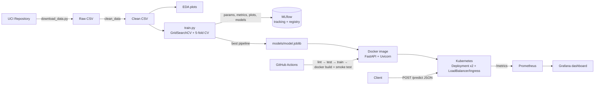

# Heart Disease Risk Prediction: End-to-End MLOps Project

This project trains a classifier that predicts heart-disease risk from patient health data (UCI Heart Disease, Cleveland subset). It then serves the model as a monitored REST API that runs in Docker and Kubernetes.

| Assignment task | Where it is in this repo |
|---|---|
| 1. Data acquisition and EDA | `heart_disease/download_data.py`, `heart_disease/data.py`, `heart_disease/eda.py`, `notebooks/` |
| 2. Feature engineering and models | `heart_disease/features.py`, `heart_disease/train.py` (LogReg, Random Forest, Gradient Boosting) |
| 3. Experiment tracking | MLflow (`mlflow.db` and `mlruns/`), logged from `train.py` |
| 4. Packaging and reproducibility | `models/model.joblib` (preprocessing + model pipeline), MLflow model registry, `requirements.txt` |
| 5. CI/CD and tests | `tests/` (28 pytest tests), `.github/workflows/ci.yml` |
| 6. Containerization | `Dockerfile`, `api/` (FastAPI `/predict`) |
| 7. Deployment | `k8s/` (Deployment, LoadBalancer Service, Ingress, HPA) |
| 8. Monitoring and logging | `api/monitoring.py`, `/metrics`, `docker-compose.yml` (Prometheus + Grafana) |
| 9. Documentation | This README plus `screenshots/` |

---

## Architecture



## Project structure

```
heart-disease-mlops/
├── heart_disease/           # ML package
│   ├── config.py            # paths, feature lists, constants
│   ├── download_data.py     # download + clean dataset
│   ├── data.py              # loading / cleaning functions
│   ├── features.py          # sklearn ColumnTransformer pipeline
│   ├── eda.py               # EDA figures -> reports/figures
│   ├── train.py             # tuning, CV, MLflow logging, model selection
│   └── predict.py           # inference helpers + CLI
├── api/                     # FastAPI service (main.py, schemas.py, monitoring.py)
├── tests/                   # pytest unit tests (data, features, model, API)
├── data/raw, data/processed # raw + cleaned dataset
├── models/                  # model.joblib + metadata.json (served model)
├── notebooks/               # walkthrough notebook
├── k8s/                     # Kubernetes manifests
├── monitoring/              # Prometheus config + Grafana provisioning/dashboard
├── scripts/                 # smoke_test.py, run_pipeline.sh / .ps1
├── samples/                 # sample JSON requests
├── screenshots/             # put report screenshots here
├── .github/workflows/ci.yml # CI/CD pipeline
├── Dockerfile, docker-compose.yml
├── requirements.txt         # full dev/training environment
└── requirements-api.txt     # slim serving environment (Docker)
```

---

## 1. Setup (VS Code)

Prerequisites:
- Python **3.11, 3.12 or 3.13**. pandas 3 needs Python 3.11 or newer.
- Git
- VS Code with the Python extension
- Docker Desktop, for tasks 6 to 8

Open the project folder in VS Code and open a terminal (`Ctrl+``).

**Windows (PowerShell)**
```powershell
python -m venv .venv
.\.venv\Scripts\Activate.ps1          # if blocked: Set-ExecutionPolicy -Scope CurrentUser RemoteSigned
python -m pip install --upgrade pip
pip install -r requirements.txt
```

**Linux / macOS**
```bash
python3 -m venv .venv
source .venv/bin/activate
pip install --upgrade pip
pip install -r requirements.txt
```

Next, press `Ctrl+Shift+P`, choose **Python: Select Interpreter**, and pick `.venv`.

> All commands below are run from the **project root** with the venv activated.
> You can also use the **Run and Debug** panel. `.vscode/launch.json` has ready-made configs for every step.

### Run everything in one go
```powershell
powershell -ExecutionPolicy Bypass -File scripts\run_pipeline.ps1     # Windows
bash scripts/run_pipeline.sh                                          # Linux/macOS
```

---

## 2. Step-by-step

### Task 1: Data and EDA
```bash
python -m heart_disease.download_data   # -> data/raw/processed.cleveland.data, data/processed/heart_clean.csv
python -m heart_disease.eda             # -> reports/figures/*.png, reports/eda_summary.txt
```
Cleaning does the following:
- Turns `?` into NaN.
- Drops duplicate rows.
- Converts the target `num` (0–4) to a binary target (`>0` → 1).
- Fills missing values with the median for numeric columns and the mode for categorical ones. In the raw data, `ca` has 4 missing values and `thal` has 2.

EDA figures: class balance, histograms by class, categorical count plots, correlation heatmap, boxplots and target correlation.

### Tasks 2–4: Training, MLflow and packaging
```bash
python -m heart_disease.train           # full grid search (~1 min)
python -m heart_disease.train --quick   # small grids (CI)
```

**Preprocessing**
- Numeric columns go through `SimpleImputer(median)` and then `StandardScaler`.
- Categorical columns go through `SimpleImputer(mode)` and then `OneHotEncoder(handle_unknown="ignore")`.
- Preprocessing is part of the saved pipeline, so training and serving apply the exact same steps.

**Models and tuning**
- The models are Logistic Regression, Random Forest and Gradient Boosting.
- Each one is tuned with `GridSearchCV` (stratified 5-fold, scoring = ROC-AUC) on an 80% stratified training split.

**Metrics**
- For cross-validation (mean ± std) and the 20% hold-out test set: accuracy, precision, recall, F1 and ROC-AUC.

**Model selection**
- The model with the best mean CV ROC-AUC wins. The test set is used only for reporting.
- The winner is saved to `models/model.joblib` and `models/metadata.json`. It is also registered as `heart-disease-classifier` in the MLflow Model Registry.

**MLflow logging**
- Each model family gets a parent run that logs:
  - best params
  - CV and test metrics
  - plots: confusion matrix, ROC, PR curve, feature importance
  - classification report and `cv_results.csv`
  - the model, with its signature and an input example
- Each grid candidate is logged as a nested child run.

Results from one run:

| model | CV ROC-AUC | Test ROC-AUC | Test accuracy |
|---|---|---|---|
| logistic_regression (selected) | 0.904 | 0.967 | 0.869 |
| random_forest | 0.902 | 0.948 | 0.852 |
| gradient_boosting | 0.885 | 0.960 | 0.902 |

**MLflow UI**
```bash
mlflow ui --backend-store-uri sqlite:///mlflow.db --port 5000
```
Then open http://localhost:5000. Take screenshots of the runs list, the run comparison, metrics charts, artifacts and the registered model.

**Inference from the command line**
```bash
python -m heart_disease.predict --input samples/sample_request.json
```

### Task 5: Tests and CI/CD
```bash
flake8 heart_disease api tests scripts
pytest                       # 28 tests: data, features, model, API
pytest --cov=heart_disease --cov=api --cov-report=term
```

To run the GitHub Actions pipeline, push the repo to GitHub. `.github/workflows/ci.yml` runs these jobs:
1. **lint**: flake8
2. **test**: pytest with coverage. The JUnit and coverage XML files are uploaded as artifacts.
3. **train**: downloads the data, then runs EDA, training and an inference check. The model, reports and MLflow runs are uploaded as artifacts.
4. **docker**: builds the image, runs the container, smoke-tests `/health`, `/predict` and `/predict/batch`, prints the container logs and uploads the image as an artifact.

Each job depends on the one before it, so any lint, test, training or smoke-test error fails the pipeline with clear logs.
```bash
git init && git add . && git commit -m "Heart disease MLOps pipeline"
git branch -M main
git remote add origin https://github.com/<your-user>/heart-disease-mlops.git
git push -u origin main
```

### Run the API locally (without Docker)
```bash
uvicorn api.main:app --host 0.0.0.0 --port 8000 --reload
```
- Swagger UI: http://localhost:8000/docs
- Smoke test: `python scripts/smoke_test.py --requests 20`

Example call with curl (Linux/macOS/Git-Bash):
```bash
curl -X POST http://localhost:8000/predict -H "Content-Type: application/json" -d @samples/sample_request.json
```
The same call in PowerShell:
```powershell
Invoke-RestMethod -Uri http://localhost:8000/predict -Method Post -ContentType "application/json" -InFile samples/sample_request.json
```
Response:
```json
{"prediction": 0, "label": "No heart disease", "probability_disease": 0.3253, "confidence": 0.6747,
 "model_name": "logistic_regression", "model_version": "1.0.0"}
```

### Task 6: Docker
Train first, because the image copies `models/` into it.
```bash
docker build -t heart-disease-api:latest .
docker run -d --name heart-api -p 8000:8000 heart-disease-api:latest
python scripts/smoke_test.py --url http://localhost:8000
docker logs heart-api
docker stop heart-api && docker rm heart-api
```

### Task 7: Kubernetes deployment

**Option A: Docker Desktop.** Turn on Kubernetes under Settings → Kubernetes. The locally built image is available to the cluster directly.
```bash
docker build -t heart-disease-api:latest .
kubectl apply -f k8s/namespace.yaml
kubectl apply -f k8s/deployment.yaml -f k8s/service.yaml
kubectl -n heart-mlops get pods,svc          # wait for 2/2 Running, EXTERNAL-IP = localhost
python scripts/smoke_test.py --url http://localhost:80
```

**Option B: Minikube**
```bash
minikube start
minikube image load heart-disease-api:latest      # or: eval $(minikube docker-env) && docker build ...
kubectl apply -f k8s/namespace.yaml -f k8s/deployment.yaml -f k8s/service.yaml
minikube tunnel                                   # separate terminal, gives the LoadBalancer an IP
kubectl -n heart-mlops get svc heart-disease-api  # use EXTERNAL-IP
# or simply: minikube service heart-disease-api -n heart-mlops --url
```

**Optional: Ingress and autoscaling**
```bash
minikube addons enable ingress            # Docker Desktop: install ingress-nginx (see k8s/ingress.yaml)
kubectl apply -f k8s/ingress.yaml          # add "<ip> heart-api.local" to your hosts file
kubectl apply -f k8s/hpa.yaml              # needs metrics-server
```

**Useful checks for screenshots**
```bash
kubectl -n heart-mlops get all
kubectl -n heart-mlops describe deployment heart-disease-api
kubectl -n heart-mlops logs -l app=heart-disease-api --tail=50
```
For a cloud cluster (GKE, EKS or AKS):
1. Push the image to a registry, for example `docker tag heart-disease-api:latest <registry>/heart-disease-api:v1 && docker push ...`.
2. Change `image:` in `k8s/deployment.yaml` to that image.
3. Apply the same manifests.

### Task 8: Monitoring and logging
- **Request logging:** every request is logged as JSON with its request id, method, path, status and latency. Logs go to stdout and to `logs/api.log`, which rotates. Each prediction is logged with its input and confidence.
- **Metrics at `/metrics`:**
  - `api_requests_total`
  - `api_request_latency_seconds`
  - `model_predictions_total{prediction}`
  - `model_prediction_confidence`
  - `model_prediction_errors_total`
  - `model_loaded`

Start the full stack:
```bash
docker compose up -d --build
python scripts/smoke_test.py --requests 200      # generate traffic
```
- Prometheus: http://localhost:9090. Try the query `api_requests_total`.
- Grafana: http://localhost:3000 (admin / admin). Open the **MLOps → Heart Disease API - Monitoring** dashboard. It is provisioned automatically and shows request rate, p50/p95 latency, predictions by class, status codes, error rate and average confidence.

Stop the stack with `docker compose down`.

---

## Screenshots to collect (`screenshots/`)
1. EDA figures (from `reports/figures/`)
2. MLflow runs list, run comparison, artifacts, model registry
3. `pytest` output and the GitHub Actions run (all 4 jobs green, with artifacts)
4. `docker build` / `docker run` and the smoke-test output, plus Swagger `/docs` with a `/predict` call
5. `kubectl get all`, pods running, and a `/predict` call through the LoadBalancer or Ingress
6. Prometheus targets page and the Grafana dashboard

## Troubleshooting
- **`ModuleNotFoundError: heart_disease`**: run commands from the project root, using `python -m ...`.
- **`Model not loaded` (503)**: run `python -m heart_disease.train` before starting the API or building the image.
- **PowerShell will not activate the venv**: run `Set-ExecutionPolicy -Scope CurrentUser RemoteSigned`.
- **Kubernetes `ErrImagePull`**: the image is not inside the cluster. Use `minikube image load ...` and keep `imagePullPolicy: IfNotPresent`.
- **Port 8000 is already in use**: stop the old container with `docker rm -f heart-api`, or use a different port, for example `-p 8080:8000`.
